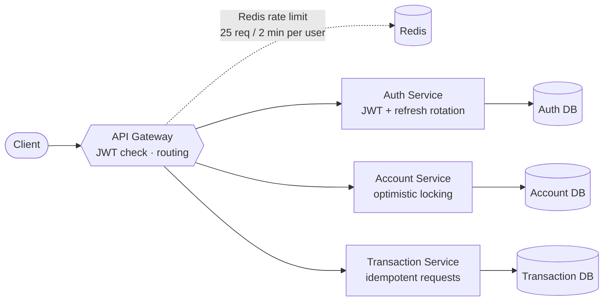

<!-- ═══════════════ HEADER (animated wave) ═══════════════ -->
<p align="center">
  
</p>

<!-- ═══════════════ TYPING ANIMATION ═══════════════ -->
<p align="center">
  <a href="https://git.io/typing-svg">
    
  </a>
</p>

<p align="center">
  
  
  
</p>

<p align="center">
  <a href="mailto:siddaroodh2004@gmail.com"></a>
  <a href="https://www.linkedin.com/in/siddaroodh-venkatapur-821551262/"></a>
  <a href="https://siddaroodh-portfolio.vercel.app/"></a>
  <a href="https://leetcode.com/u/siddaroodh__2004/"></a>
</p>

<p align="center">
  
</p>

<!-- ═══════════════ TERMINAL CARD ═══════════════ -->
## 👨‍💻 `whoami`

```bash
$ whoami
siddaroodh — backend engineer

$ cat about.txt
 role      : Backend Engineer / SDE Intern (open to opportunities)
 education : B.Tech CSE, Alliance University, Bengaluru (2026)
 focus     : architecture · authN/authZ · transaction consistency · concurrency
 mindset   : "If I can't load-test it, I don't trust it."

$ ls ./now
 core-banking-system/       # microservices, JWT, RBAC, optimistic locking
 game-recommendation-rag/   # RAG-based game recommender (in progress)

$ cat achievements.txt
 ✔ 300+ DSA problems solved on LeetCode (Java)
 ✔ Gold-rated on HackerRank (Python)
 ✔ OCI 2025 Certified Generative AI Professional
```

<!-- ═══════════════ IMPACT METRICS ═══════════════ -->
## 📈 Proven, Not Promised

<table align="center">
  <tr>
    <td align="center" width="25%">
      <h1>0</h1>
      <b>data leaks</b><br/>
      <sub>10 simultaneous requests,<br/>2 users sharing an idempotency key</sub>
    </td>
    <td align="center" width="25%">
      <h1>100%</h1>
      <b>balance accuracy</b><br/>
      <sub>35 concurrent requests<br/>with optimistic locking</sub>
    </td>
    <td align="center" width="25%">
      <h1>0</h1>
      <b>duplicate transactions</b><br/>
      <sub>10 concurrent duplicates,<br/>DB-enforced idempotency</sub>
    </td>
    <td align="center" width="25%">
      <h1>30+</h1>
      <b>REST endpoints</b><br/>
      <sub>Auth · Account · Transaction<br/>services</sub>
    </td>
  </tr>
</table>

<!-- ═══════════════ FEATURED PROJECT ═══════════════ -->
## 🏦 Core Banking System

> A microservices banking backend built around **correctness under concurrency**, not just CRUD.



<sub>Database-per-service: each microservice owns its own PostgreSQL database.</sub>

<details open>
<summary><b>🔐 Security & Correctness Highlights</b></summary>
<br/>

| Area | What I built |
| :-- | :-- |
| **Authorization** | Fixed a cross-user gap in idempotent request handling and verified it with a concurrent 2-user test |
| **Consistency** | Optimistic locking for transaction consistency under 35 concurrent requests |
| **Idempotency** | Database-enforced key handling that removes duplicate processing |
| **Auth** | JWT with refresh-token rotation and RBAC |
| **Gateway** | Centralized routing and Redis rate limiting with structured `429` responses |

</details>

<p>
  
  
  
  
  
  <a href="https://github.com/digital-banking-platform/Core-Banking-System"></a>
</p>

---

## 🤖 ATS Launchpad

> AI-powered ATS: resume analysis, job matching, skill-gap detection and resume-based skill tests.

- 🧠 **GPT-OSS-20B** via Spring AI for resume/job-fit analysis and skill-gap detection
- ⚡ **Real-time SSE streaming** with JWT-based auth for progressive result delivery
- 📄 **Apache Tika** for resume parsing across document formats

<p>
  
  
  
  
  <a href="https://github.com/siddaroodh05/ATS-Launchpad"></a>
</p>

---

## 🎮 Currently Building: RAG Game Recommendation System

Retrieval-augmented game recommendations, with LLM-generated queries and vector search.

<a href="https://github.com/siddaroodh05/rag-game-recommendation-system"></a>

---

## 🧰 Tech Stack

<p align="center">
  
</p>

<table align="center">
  <tr><td><b>Languages</b></td><td>Java · SQL · Python</td></tr>
  <tr><td><b>Backend</b></td><td>Spring Boot · Spring Security · Spring Data JPA · Hibernate · REST · Microservices · API Gateway</td></tr>
  <tr><td><b>Data</b></td><td>PostgreSQL · Redis</td></tr>
  <tr><td><b>Tools</b></td><td>Git · GitHub · Docker · Postman</td></tr>
  <tr><td><b>Frontend</b></td><td>React.js</td></tr>
  <tr><td><b>Core CS</b></td><td>DSA · OOP · DBMS · Operating Systems · Computer Networks</td></tr>
</table>

---

## 📂 More Projects

| Project | Description |
| :-- | :-- |
| [**rag-game-recommendation-system**](https://github.com/siddaroodh05/rag-game-recommendation-system) | Retrieval-augmented generation for game recommendations |
| [**Stock-Portfolio-Optimization**](https://github.com/siddaroodh05/Stock-Portfolio-Optimization) | Portfolio optimization in Python / Jupyter |
| [**DMart-Clone-React**](https://github.com/siddaroodh05/DMart-Clone-React-E-Commerce-Web-Application) | Responsive React storefront: cart, search, categories, PDP |
| [**siddaroodh-portfolio**](https://github.com/siddaroodh05/siddaroodh-portfolio) | Personal portfolio site |

---

## 📊 GitHub Activity

<p align="center">
  
  
</p>

<p align="center">
  
</p>

<p align="center">
  
</p>

<p align="center">
  
</p>

<p align="center">
  
</p>

<!-- Contribution snake: needs the workflow in .github/workflows/snake.yml -->
<p align="center">
  <picture>
    <source media="(prefers-color-scheme: dark)" srcset="https://raw.githubusercontent.com/siddaroodh05/siddaroodh05/output/github-contribution-grid-snake-dark.svg" />
    <source media="(prefers-color-scheme: light)" srcset="https://raw.githubusercontent.com/siddaroodh05/siddaroodh05/output/github-contribution-grid-snake.svg" />
    
  </picture>
</p>

---

## 🤝 Let's Connect

<p align="center"><i>Open to Backend Engineer / SDE Intern opportunities. Feel free to reach out.</i></p>

<p align="center">
  <a href="mailto:siddaroodh2004@gmail.com"></a>
  <a href="https://www.linkedin.com/in/siddaroodh-venkatapur-821551262/"></a>
</p>


